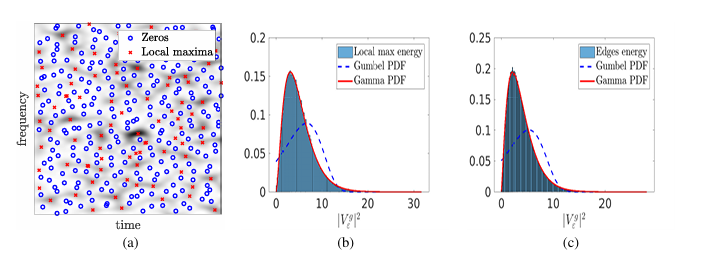
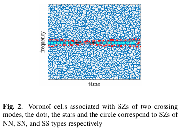
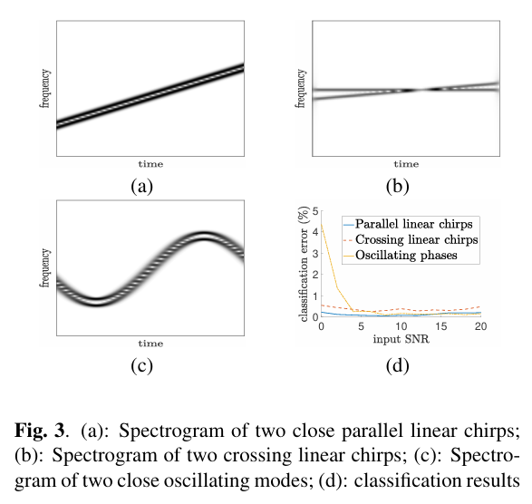
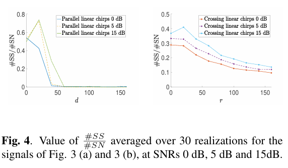
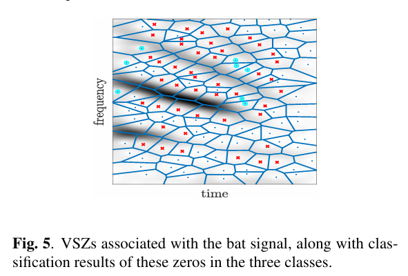

# [Time-Frequency Analysis]A New Method for Classifying Zeros in Spectral Plots of Multicomponent Signal Based on Voronoi Units[With MATLAB Code]

This paper proposes a novel method for classifying the zero points (SZs) in the spectral diagram of multi-component signals based on Voronoi units associated with the zero points (SZs) of the analysis spectrum. More precisely, by characterizing the distribution of the maximum values of the complex Gaussian white noise (CWGN) spectral diagram at the edges related to the SZs, an algorithm is derived for classifying different types of zero points present in the spectral diagram of multi-component signals. The effectiveness of the proposed classification algorithm was verified numerically through simulations of analog signals, and the paper concludes with an analysis of real signals.
Introduction Over the past two decades, analyzing non-stationary multi-component signals (MCS) from spectral analysis has been a research hotspot due to the fact that these signals' patterns form ridges on the time-frequency (TF) plane, which can be used for instantaneous frequency (IF) estimation and mode reconstruction. These ridges correspond to the local maxima along the frequency axis of the spectral diagram, hence it is commonly believed that the important information in the spectral diagram resides at these maxima.
However, in [3], Bargmann decomposition pointed out that the Short Time Fourier Transform (STFT) can be considered as a resolvent function, whose complete representation is solely characterized by the positions of the zero points. Moreover, the distribution of zero points (SZs) in the spectral diagram of complex Gaussian white noise (CWGN) follows specific patterns, which were utilized by [3] to distinguish signals from noise using Delaunay triangulation of the SZs. [5] further mathematically described the distribution of CWGN's SZs, indicating that they are uniform on the TF plane, meaning that if there are no zero points in a region, it is likely related to signal information. Notably, these findings preceded the application of SZs in time-frequency analysis of auditory systems, where reassignment techniques demonstrated the repellent effect of SZs. Additionally, [7] investigated the behavior of STFT phase near SZs.
The existing methods for separating noise from signals either use SZs or local maxima of the spectrum plot, but not both simultaneously. This paper proposes an algorithm based on the maximum coefficients of the Voronoï unit edges (VSZs) related to SZs in the spectrum plot to categorize MCS's SZs into three categories. The fundamental principle of this strategy is as described in [8], where the maximum coefficients of the spectrum plot are located near the VSZs edges.
Figure caption:
Conclusion - This paper presents a method for classifying zero points in the spectrum plot of noisy multi-component signals. These zero points are generated by different types of interference, respectively labeled as noise-noise (NN), signal-noise (SN), and signal-signal (SS). By conducting in-depth research on the distribution of spectral plot coefficients associated with Voronoï unit edges in pure noise, we can accurately classify the zero points in the spectrum plot of noisy multi-component signals into the above three categories.
End

## Images

<!-- PAYMENT_BLOCK -->

## Get this dataset

- Payment link (Stripe): [Buy now](https://buy.stripe.com/3cs8yP7sY87d0vu9AB)
- Payment QR code: 

<!-- /PAYMENT_BLOCK -->
